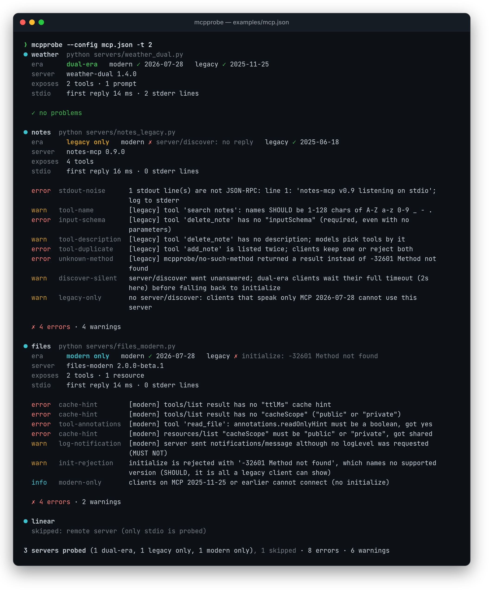

<p align="center">
  
</p>

<h3 align="center">Start a stdio MCP server the way 2026-07-28 and 2025-11-25 clients do, and see what breaks.</h3>

<p align="center">
  <a href="https://github.com/celaldrg/mcpprobe/actions/workflows/ci.yml"></a>
  <a href="https://github.com/celaldrg/mcpprobe/releases"></a>
  <a href="LICENSE"></a>
  
  
</p>

## Why

The [MCP 2026-07-28 specification](https://modelcontextprotocol.io/specification/2026-07-28) made the protocol stateless. The `initialize` / `notifications/initialized` handshake is gone: a modern client sends `server/discover` (or any request) with its protocol version, identity and capabilities in `_meta`, and list results must carry `resultType`, `ttlMs` and `cacheScope`. Clients on 2025-11-25 and earlier still do the handshake. For a while every stdio server has to work with both, and most servers are somewhere in between.

Static linters can't tell you which era a server actually speaks; only starting it can. And the stdio problems that hurt most (a banner printed to stdout, a request that never gets an answer, a process that ignores EOF) only show up at runtime, usually as a client that hangs with no error.

`mcpprobe` starts the server twice, once as a 2026-07-28 client and once as a 2025-11-25 client, lists its tools, prompts and resources (it **never calls a tool**), sends one unknown method, closes stdin and watches the process exit. Then it reports:

- **Protocol era**: `dual-era`, `modern only`, `legacy only` or `unreachable`, with the versions each side negotiated, and whether the tool list differs between eras.
- **Stdio hygiene**: non-JSON lines on stdout (with the offending text), batches, missing `"jsonrpc": "2.0"`, replies to ids that were never sent, server-to-client requests a 2026-07-28 server must not send, unsolicited log notifications, crashes with the last stderr line, no exit after stdin closes.
- **Modern rules**: `server/discover` shape, `supportedVersions`, `_meta` server info, `resultType`, `ttlMs` and `cacheScope` on every cacheable result, `UnsupportedProtocolVersionError` with `data.supported` (and a retry with the newer version it offers).
- **Legacy rules**: `initialize` result shape, negotiated version, `serverInfo`, `ping`, and whether a modern-only server rejects `initialize` with a message that names a version.
- **Shape**: tools without `inputSchema` or with a non-object one, duplicate tool names, names outside `A-Z a-z 0-9 _ - .`, missing descriptions, non-boolean annotations, prompts and resources without names or URIs, capabilities that are advertised but fail (or answer without being advertised), endless pagination.
- **Silences**: an unanswered `server/discover` makes every dual-era client wait for its full timeout before it falls back to `initialize`. mcpprobe tells you how long.

Standard library only. `--json` for CI, `--strict` to fail on warnings, `--config` to probe every stdio server in a `.mcp.json`, Claude Desktop, Cursor, VS Code or Gemini config at once.

<p align="center">
  
  <br><sub>Real output: <code>mcpprobe --config mcp.json -t 2</code> in <a href="examples">examples/</a>. One clean dual-era server, one legacy server with the usual stdio bugs, one modern-only server missing cache hints, one remote server skipped.</sub>
</p>

## Install

```sh
pipx install git+https://github.com/celaldrg/mcpprobe@v0.1.0
# or
uv tool install git+https://github.com/celaldrg/mcpprobe@v0.1.0
# or, one-off
uvx --from git+https://github.com/celaldrg/mcpprobe mcpprobe -- npx -y @modelcontextprotocol/server-memory
```

The [v0.1.0 release](https://github.com/celaldrg/mcpprobe/releases/tag/v0.1.0) also has a wheel: `pip install mcpprobe-0.1.0-py3-none-any.whl`. Python 3.10+, no dependencies, Linux, macOS and Windows.

## Usage

```text
mcpprobe [options] -- <command> [args...]
mcpprobe [options] --config <file> [--server <name>]...

  -c, --config <file>   probe every stdio server in an MCP config
  -s, --server <name>   only probe this server from --config (repeatable)
  --era <modern|legacy> probe only one era (default: both)
  -t, --timeout <sec>   per-request timeout (default: 5)
  --json                machine-readable output
  --strict              exit 1 on warnings too
  -q, --quiet           hide info lines
  --no-color            disable colors (also NO_COLOR=1)
```

Exit codes: `0` no errors, `1` problems found, `2` usage error or nothing to probe.

```sh
mcpprobe -- npx -y @modelcontextprotocol/server-filesystem ~/projects   # any stdio command
mcpprobe -- uv run my_server.py                                         # your own server
mcpprobe --config .mcp.json                                             # every server in a config
mcpprobe --config ~/.cursor/mcp.json -s github -s linear                # just these two
mcpprobe --era modern --strict --json -- node dist/index.js             # CI gate for a 2026-07-28 server
```

`${VAR}` and `${VAR:-default}` in configs are expanded from your environment the way Claude Code does it, `env` and `cwd` are honoured, and remote (`url`) servers are listed as skipped. VS Code's JSONC (comments, trailing commas) is fine.

## Example

<p align="center">
  
  <br><sub>Recorded with <a href="https://github.com/charmbracelet/vhs">vhs</a>: the clean example server, the broken legacy one, then the real <code>@modelcontextprotocol/server-filesystem</code> from npm.</sub>
</p>

[`examples/servers/notes_legacy.py`](examples/servers/notes_legacy.py) is a small legacy server with the mistakes real servers ship with:

```text
$ mcpprobe -q -t 2 -- python servers/notes_legacy.py
● python servers/notes_legacy.py
  era      legacy only   modern ✗ server/discover: no reply   legacy ✓ 2025-06-18
  server   notes-mcp 0.9.0
  exposes  4 tools
  stdio    first reply 14 ms · 0 stderr lines

  error  stdout-noise      1 stdout line(s) are not JSON-RPC: line 1: 'notes-mcp v0.9 listening on stdio'; log
                           to stderr
  warn   tool-name         [legacy] tool 'search notes': names SHOULD be 1-128 chars of A-Z a-z 0-9 _ - .
  error  input-schema      [legacy] tool 'delete_note' has no "inputSchema" (required, even with no
                           parameters)
  warn   tool-description  [legacy] tool 'delete_note' has no description; models pick tools by it
  error  tool-duplicate    [legacy] tool 'add_note' is listed twice; clients keep one or reject both
  error  unknown-method    [legacy] mcpprobe/no-such-method returned a result instead of -32601 Method not
                           found
  warn   discover-silent   server/discover went unanswered; dual-era clients wait their full timeout (2s here)
                           before falling back to initialize
  warn   legacy-only       no server/discover: clients that speak only MCP 2026-07-28 cannot use this server

  ✗ 4 errors · 4 warnings
```

A finding tagged `[legacy]` or `[modern]` was seen in one session only; untagged ones happened in both.

### Real servers

Probed on 18 November 2026 with mcpprobe 0.1.0 (latest versions from npm and PyPI):

| Server | Era | Result |
| --- | --- | --- |
| `@modelcontextprotocol/server-filesystem` 2.4.0 | dual-era | no problems |
| `@modelcontextprotocol/server-memory` 2.2.1 | dual-era | no problems |
| `@modelcontextprotocol/server-everything` 2.3.1 | dual-era | `era-drift`: 4 tools only in the modern session, 2 only in the legacy one (deliberate in this test server) |
| `@upstash/context7-mcp` 4.7.3 | dual-era | no problems |
| `mcp-server-fetch`, `mcp-server-time` (uvx) | dual-era | no problems |
| `@playwright/mcp` 1.66.0-alpha | legacy only | `server/discover` → -32601, so 2026-07-28-only clients can't use it yet |

### JSON

```sh
mcpprobe --json --config .mcp.json | jq '.servers[] | {name, era, errors, warnings}'
```

Every server object has `era`, the `modern` and `legacy` session details (negotiated version, capabilities, tool / prompt / resource names, timings), `serverInfo`, `stderrLines` and `findings` (`level`, `code`, `message`, optional `era`).

## In CI

```yaml
- run: pipx install git+https://github.com/celaldrg/mcpprobe@v0.1.0
- run: npm run build
- run: mcpprobe --strict -- node dist/index.js
```

## How it works

Two fresh processes, never one, because a modern client and a legacy client are different programs and a server must not rely on state from the other session.

| Session | Sends | Then |
| --- | --- | --- |
| modern | `server/discover` with `_meta` `io.modelcontextprotocol/protocolVersion: 2026-07-28`, `clientInfo`, `clientCapabilities` | `tools/list`, `prompts/list`, `resources/list` (following `nextCursor`), each with `_meta`; one unknown method; close stdin |
| legacy | `initialize` (2025-11-25), `notifications/initialized`, `ping` | the same lists without `_meta`; one unknown method; close stdin |

A background thread reads stdout line by line and keeps every line that is not a JSON-RPC message instead of skipping it, which is what makes the stdout-noise and wrong-id findings possible. Server-to-client requests in the legacy session get a `-32601` reply so the server is not left waiting. Tools are listed, never called, so probing a server that can write files or send messages is safe; it still runs the server's own startup code, so only probe commands you would run anyway.

## Related

- [mcpaudit](https://github.com/celaldrg/mcpaudit): audit the MCP config files themselves (hardcoded secrets, unpinned `npx`/`uvx`, plain-HTTP remotes).
- [mcpdiff](https://github.com/celaldrg/mcpdiff): diff two `tools/list` snapshots and flag breaking changes.
- [schemafit](https://github.com/celaldrg/schemafit): check tool input schemas against OpenAI and Claude strict mode.

## License

[MIT](LICENSE)
